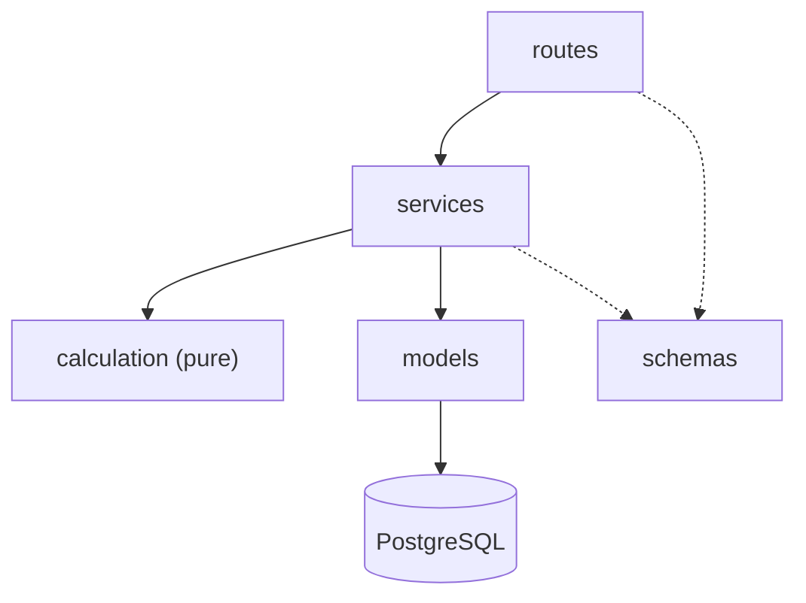
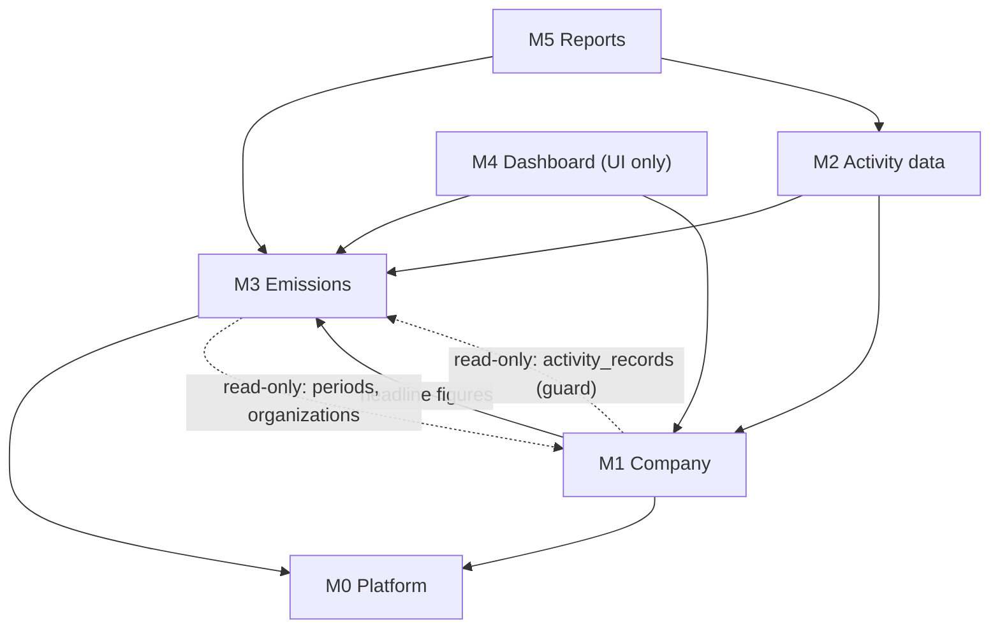
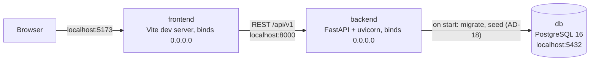
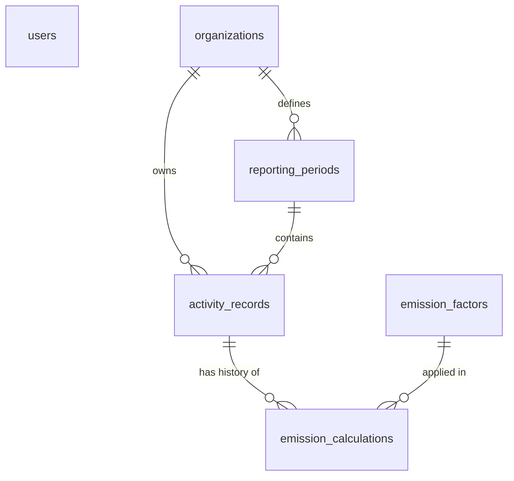

# Architecture Spine — CarbonTrack

This spine is the contract. The CP2 architecture, [architecture-carbontrack-detail.md](architecture-carbontrack-detail.md), stays beside it as the reference for anything no AD covers; where the two disagree, this spine wins.

## Design Paradigm

**Layered modular monolith.** One backend, one frontend, one database. Each module (M0–M5) owns its tables and its slice of every layer; layers depend only downward.

| Layer | Backend | Frontend |
| --- | --- | --- |
| Entry | `app/api/v1/routes` — HTTP only | `pages/` — one component per route |
| Behavior | `app/services` — rules, queries, flushes | `hooks/` — TanStack Query hooks, the only callers of services |
| Core | `app/calculation` — pure emission arithmetic, no I/O | `services/` + `apiClient.ts` — typed API calls, no React |
| Data / shared | `app/models`, `app/schemas`, `app/db`, `app/core` | `components/ui` (M0), `components/charts` (M4), `components/<feature>` |

## Invariants & Rules

### AD-1 — Layers depend only downward [ADOPTED]

- **Binds:** all
- **Prevents:** business rules leaking into routes or pages, and I/O leaking into the calculation engine.
- **Rule:** A route parses input, calls one service method and returns a schema; it never queries or commits. A service holds rules and queries and flushes; it never commits (AD-4) and never imports FastAPI. The calculation engine imports only the standard library. A page never calls `fetch`; data flows page → hook → service → `apiClient`.



### AD-2 — One schema owner and one row writer per table [ADOPTED, amended by Decision A]

- **Binds:** M0–M5, every migration
- **Prevents:** two modules altering, or writing rows of, the same table in different ways.
- **Rule:** Schema owners (migrations, models, constraints, indexes): M0 `users`; M1 `organizations`, `reporting_periods`; M3 `activity_records`, `emission_factors`, `emission_calculations`. Each table's rows are written only by its schema owner's services, with one exception: `activity_records` rows are inserted, updated and deleted only by `ActivityService` (M2). `EmissionCalculationService` writes only `emission_calculations`, and `EmissionFactorService` only `emission_factors`. M3 builds no activity write path in `app/`; its tests create activity rows through a test-only factory in `backend/tests/factories.py` that app code never imports. M3's migrations include the indexes `activity_records (organization_id, activity_date, id)`, `activity_records (reporting_period_id, activity_type)` and `emission_calculations (activity_record_id) WHERE is_current`. A module that needs another index on a table it does not own asks the owner for it; it never alters that table.

### AD-3 — Cross-module calls follow one acyclic service graph [ADOPTED, amended]

- **Binds:** M0–M5 services
- **Prevents:** circular imports, and two modules each assuming the other owns a rule.
- **Rule:** These rules govern calls between modules; services within one module may call each other. The only cross-module service calls are: ActivityService (M2) → ReportingPeriodService (M1) and → EmissionCalculationService (M3); EmissionCalculationService → EmissionFactorService and the engine; OrganizationService (M1) → EmissionsQueryService (M3), for headline figures only; ReportService (M5) → EmissionsQueryService and ActivityService. Reading another module's table through its model is allowed only in `ReportingPeriodService` (`activity_records`, for the period-edit guard) and in `EmissionsQueryService` and `ReportService` (`reporting_periods`, `organizations`, for period dates and names), and only for reading. An import-linter contract in CI enforces AD-1 and AD-3.



### AD-4 — The entry point owns the unit of work [ADOPTED, amended]

- **Binds:** all write services, the seed, the test fixture; R21, R23, R32
- **Prevents:** half-applied requests, constraint violations surfacing as 500s, and a half-seeded demo organization.
- **Rule:** For HTTP, M0's `get_db` opens one session per request, commits once after the route returns, and rolls back on any exception before the error envelope is sent. For the seed, M0's runner opens one session per seed step and commits once per step (AD-15). Services never call `commit()` or `rollback()`; after a write a database constraint guards, they `flush()`, catch `IntegrityError` and raise the domain error. An activity write and its calculation, and a whole recalculation, therefore commit together or not at all. Tests wrap each test in an outer transaction with `join_transaction_mode="create_savepoint"`.

### AD-5 — Exact decimals, one set of response types [ADOPTED, amended]

- **Binds:** M3, M2, M5, M1, M4; R23–R28, R34–R36, R41–R45; NFR-01
- **Prevents:** totals and shares that differ between the database, the API, the dashboard and a CSV.
- **Rule:** Emission arithmetic uses Python `Decimal` and PostgreSQL `NUMERIC`, never binary floating point. Rounding happens only in the engine: emissions to 6 decimals half-up, and shares only in `share(part, total)` in `app/calculation`, a fraction from 0 to 1 at 6 decimals, 0 when the total is 0. Column types: `quantity` and `quantity_used` NUMERIC(13,3); factor `value` and `factor_value_used` NUMERIC(12,6); `emissions_kg_co2e` NUMERIC(22,6); aggregates unbounded NUMERIC. M0's `app/schemas/common.py` defines the only decimal response types — `Quantity` (3 dp), `FactorValue` (6 dp), `KgCo2e` (6 dp), `Share` (6 dp) — each serialized as a JSON number after quantizing; no response schema declares a bare `Decimal`. JSON numbers are exact at 2 decimals below about 9×10¹³ kg and at 6 decimals below about 9×10⁹ kg; CSVs are written on the server from `Decimal` at full stored precision. On the frontend, M0's `utils/format.ts` is the only formatter (`formatKg`, `formatTonnes`, `formatShare` from a fraction to a whole percent), and no page does arithmetic on API figures except kg→t and the previous-period change.

### AD-6 — Factor versions are immutable and global; one disclaimer [ADOPTED, amended]

- **Binds:** M3, M2, M4, M5; R29–R31
- **Prevents:** a figure that can no longer be explained, and different disclaimer texts on screens and in files.
- **Rule:** A factor version is never updated or deleted. Adding one deactivates the active version for that type and inserts the new one in one transaction; a partial unique index allows one active version per type; every version records `created_at`. Factors apply to every organization. `DISCLAIMER` ("Demonstration factors, not official values") and `STANDARD_SOURCE_LABEL` ("Demonstration value, not an official emission factor") are constants in `app/calculation/disclaimer.py` (M3). A source label is the user's source text, then " — ", then `DISCLAIMER`, or `STANDARD_SOURCE_LABEL` when the text is blank; source text is at most 100 characters. `GET /reference-data` returns `disclaimer`; the frontend shows it only through M3's `components/emissions/DisclaimerNote`; the summary CSV's `source` column holds `STANDARD_SOURCE_LABEL`.

### AD-7 — Calculations are snapshots with one current per activity [ADOPTED, amended]

- **Binds:** M3, M2, M5; R21–R25, R32
- **Prevents:** history overwritten on edit, two current results for one activity, and responses that show calculations in different shapes.
- **Rule:** Each calculation stores the quantity, factor version and factor value it used. A partial unique index allows one current calculation per activity; earlier ones are kept and never edited. Every saved activity edit creates a new current calculation with the active factor. Totals read current calculations only. Deleting an activity removes its calculations through `ON DELETE CASCADE` on `emission_calculations.activity_record_id`; no service deletes calculations. M3's `schemas/emissions.py` defines `CalculationRead {emissionsKgCo2e, quantityUsed, calculatedAt, factor: FactorRef {id, value, unit, version, sourceLabel, createdAt}}`, and every response that contains a calculation embeds exactly this type.

### AD-8 — An activity's period is derived, never chosen [ADOPTED, amended]

- **Binds:** M0, M1, M2, M3; R16, R18, R19
- **Prevents:** activities counted in the wrong period or in none, including through concurrent edits.
- **Rule:** The covering period is found only by `ReportingPeriodService.find_covering(org_id, date)` (M1). `ActivityService` calls it on create and on every date change and raises `ACTIVITY_DATE_OUTSIDE_PERIODS` (422, field `activityDate`) when it finds none. A composite foreign key keeps period and activity in one organization: M1's migration creates `UNIQUE (id, organization_id)` on `reporting_periods` as its target, and M0's first migration enables `btree_gist`. Periods of one organization never overlap (exclusion constraint; refused as 409 `REPORTING_PERIOD_OVERLAP` naming the clashing period) and names are unique on `lower(name)`. A period edit that would leave activities outside the period is refused with 422 `REPORTING_PERIOD_EXCLUDES_ACTIVITIES` and one `details` entry per side, `{field: "startDate"|"endDate", issue: "excludes_activities", count, from, to}`, bounding only the stranded activities on that side. A period edit and every activity save that links a period first lock the period rows involved (`SELECT … FOR UPDATE`).

### AD-9 — Aggregates come from one query service, gaps filled once [ADOPTED, amended]

- **Binds:** M3, M1, M4, M5; R14, R26–R28, R34–R36, R41, R45; NFR-02
- **Prevents:** the dashboard, headline figures and reports computing totals, shares or months differently.
- **Rule:** Every total, share and monthly figure comes from `EmissionsQueryService` (M3), aggregated in SQL over current calculations, filtered by period and an optional activity type, over indexed columns, within NFR-02's 500 ms (p95) at 50,000 activity rows. A month is a `YYYY-MM` string built with `to_char(activity_date, 'YYYY-MM')`, never through a timestamp. A period's months are every calendar month from the month of its start date to the month of its end date inclusive, computed only by `period_months(start, end)` in `app/calculation/periods.py` (M3). Gaps are filled once, on the server: the monthly endpoint and the method `ReportService` calls both return every month of the period with zeros, and the client never fills months. Each month carries all three activity types; with a type filter, the other two are 0.

### AD-10 — One API convention [ADOPTED, amended]

- **Binds:** all routes and the frontend `services/`
- **Prevents:** endpoints that page, sort, filter or fail in different shapes.
- **Rule:** Base path `/api/v1`, plural kebab-case resources, organization-scoped resources under `/organizations/{orgId}`, camelCase JSON, UUID ids. Paged lists accept `page` (≥ 1) and `pageSize` (1–100, default 25; out of range gives 422 `VALIDATION_ERROR`) and return `{items, page, pageSize, total}` through M0's `Page[T]` schema and pagination dependency. The unpaged collections return an object with only an `items` array and are exactly: organizations (by name), an organization's reporting periods (newest start first), emission factors with their history, and one activity's calculation history. Sort keys are camelCase response field names (activities: `activityDate`, `activityType`, `quantity`, `emissionsKgCo2e`; report lines: `activityDate`), `-` for descending, and every sort appends `id` ascending as the final tie-breaker. Filter parameters are named `periodId`, `activityType`, `from` and `to` everywhere; an explicit `from`/`to` overrides `periodId`. Every error is `{"error": {"code", "message", "details": [{"field": <camelCase request field or null>, "issue": <snake_case>, …context}], "requestId"}}`, with status 401 authentication, 404 unknown or other-organization resource, 409 uniqueness, overlap and simultaneous factor adds, 422 validation and business rules, 500 anything else. Codes are members of one enum in `app/core/error_codes.py`, created by M0 and extended by each module. Every response carries `X-Request-ID`.

### AD-11 — Reports are two calls and streamed exports

- **Binds:** M5, M0; R41–R45
- **Prevents:** paging line items reloading the summary, and exports that diverge from the screen, break spreadsheets or arrive partial.
- **Rule:** `GET …/reports/emissions/summary` and `GET …/reports/emissions/lines?page=` are separate; exports stay at `…/reports/emissions/export?part=lines|summary`. Exports are generated on the server and streamed row by row; every text cell starting with `=`, `+`, `-` or `@` is prefixed with an apostrophe; the server aborts the connection on any mid-stream error. The client downloads only through M0's `apiClient.download(path, params)`, which sends the bearer token, reads the whole body, rejects a non-2xx envelope or a truncated body, and takes the file name from `Content-Disposition`. Tokens never go in query strings.

### AD-12 — Recalculation is read, then act, on one resource

- **Binds:** M3; R32
- **Prevents:** the count shown to the user and the work done disagreeing in scope.
- **Rule:** `GET /organizations/{orgId}/emissions/recalculate` returns `{outOfDateCount}`; `POST` on the same resource replaces exactly those calculations and returns `{updatedCount}`.

### AD-13 — Mock sign-in, stateless and unenforced [ADOPTED, amended]

- **Binds:** M0, every router; R7–R11; NFR-06
- **Prevents:** modules inventing their own auth checks or role rules, and sign-in failing with a 500.
- **Rule:** Seeded users with bcrypt hashes sign in for an HS256 bearer token valid 8 hours, with no refresh and client-only sign-out. The token's `sub` is the user id as a string; `AUTH_SECRET_KEY` must be at least 32 bytes or the backend refuses to start. A password longer than 72 bytes is refused as `INVALID_CREDENTIALS` before hashing. Every router except health, sign-in and the API docs requires a valid token; roles are labels and no endpoint checks them. Health answers without a token: 200 when API and database are up, 503 when the database is not, with each part's status.

### AD-14 — Shared UI state lives in the address, query keys and shared components [ADOPTED, amended]

- **Binds:** M0, M1, M2, M4, M5 frontends; R13, R37, R38
- **Prevents:** pages that disagree on the selected organization or period, stale figures after a save, and pages building their own states or colours.
- **Rule:** The organization is in the URL path. M1 owns `useSelectedPeriod(orgId, {allowAll})`: it reads `?period=`; when absent or not a period of this organization it resolves the default (the period containing today, else the latest `end_date`) and writes it with history replace; `period=all` is valid only where `allowAll` is set (Activities). M0's sidebar links carry the current `period`; the organization switcher drops it. The Activities page address uses exactly `period`, `type`, `from`, `to`, `sort`, `page`, `pageSize` and `add`; `?add=1` is honoured only there, and other pages link to `/organizations/:orgId/activities?add=1&period=<id>`. Server state lives only in TanStack Query under keys built by M0's `hooks/queryKeys.ts`: organization-scoped keys start `['org', orgId]`, global keys `['global', <resource>]`. Writing activities, periods or calculations invalidates `['org', orgId]`; adding a factor version or recalculating invalidates every `['org']` key and `['global', 'emission-factors']`; creating or editing an organization invalidates `['global', 'organizations']` and `['org', orgId]`. Every data view uses M0's shared loading, error and empty components; every chart uses M4's chart components, each with a table equivalent. Colour token names are fixed now and CP4 sets their values: `--color-activity-electricity`, `--color-activity-fuel`, `--color-activity-business-travel`; no component uses a raw colour.

### AD-15 — One ordered, idempotent seed and one home per reference list

- **Binds:** M0, M1, M2, M3; R4, R6, R10, R12, R33
- **Prevents:** demo data the app would refuse, seeds that re-create renamed or deleted data, and different spellings of the same value across modules.
- **Rule:** M0's `app/seed/__main__.py` runs an ordered registry of steps: `users` (M0), `factors` (M3), `demo_data` (M2). Each step is `run(session, settings)` in its owner's `app/seed/<step>.py`, writes through the owning services (demo activities through `ActivityService.create`) and commits once (AD-4). Existence keys: users by `lower(email)`; factors by "this activity type has any version"; demo data by a fixed UUID per demo organization — when it exists the step skips that organization and everything under it, otherwise it creates the organization, its periods and its activities in one transaction. Steps never update or recreate rows they find. `factors` always runs; `users` and `demo_data` run only when `SEED_DEMO_DATA` is true. Reference lists are constants with one owner each: activity types `electricity | fuel | business_travel` with units `kWh | L | km` and scope labels `Scope 2 | Scope 1 | Scope 3` in `app/calculation/activity_types.py` (M0 creates it, M3 adds the scope labels); industries in `app/core/reference/industries.py` (M1); countries (ISO 3166-1 alpha-2, English names) in `app/core/reference/countries.py` (M0). These exact strings are the values in the database, JSON, query parameters, URLs and CSVs; only display labels differ.

### AD-16 — Configuration only from the environment [ADOPTED, amended]

- **Binds:** all; NFR-06, NFR-10
- **Prevents:** secrets or machine-specific values in committed files, and dev servers unreachable from the host.
- **Rule:** Every setting comes from environment variables; `.env.example` holds placeholders only, `.env` is never committed, and nothing falls back to a committed secret. Inside their containers the dev servers bind `0.0.0.0`; Compose publishes every port on `127.0.0.1` only. `CORS_ORIGINS` lists both `http://localhost:5173` and `http://127.0.0.1:5173`.

### AD-17 — Cross-module deliveries go through seams the owner leaves

- **Binds:** M0, M1, M2, M3; R1, R6, R10, R14, R16
- **Prevents:** a later module rebuilding, or editing at will, code another module owns when Decision B moves a deliverable after its owner.
- **Rule:** A module edits another module's code only at a seam named here; the owner creates the seam when it is built, and the later module fills only that seam.
  - M1's `OrganizationDetail` has `headline: HeadlineFigures | None`. `OrganizationService.get` fills it by calling `EmissionsQueryService.headline(org_id)` once M3 exists. M3 supplies `HeadlineFigures {activityCount, totalEmissionsKgCo2e}` and the `HeadlineFigures` component, which M1's details page renders in a reserved slot. `GET /organizations` never carries headline figures.
  - M1's `ReportingPeriodService.update` calls a private `_check_activities_inside(period, start, end)` that M1 ships as a no-op; M2 implements it as a read-only query on `activity_records`. M1's period form renders `REPORTING_PERIOD_EXCLUDES_ACTIVITIES` from the start (AD-8).
  - M0's `ReferenceData` schema has `activityTypes`, `industries`, `countries`, `disclaimer` and `today` from the start, each filled from its owner's constant (AD-6, AD-15).
  - M0's sidebar entries are a list in `layouts/navigation.ts` with an `enabled` flag; M3 enables Emission Factors.
  - The seed registry (AD-15).

### AD-18 — Local operations and CI

- **Binds:** M0, M3; R4, R5; NFR-02, NFR-08, NFR-10
- **Prevents:** a backend that serves after a failed migration, colliding migration histories, and each module building its own performance data or CI.
- **Rule:**
  - The backend starts with `alembic upgrade head && python -m app.seed && uvicorn`; any failure exits non-zero, and the service has `restart: "no"`.
  - Alembic keeps one linear history; revision files are prefixed by module (`m0_`, `m1_`, `m3_`) and each `down_revision` is the current head.
  - The reset is `docker compose down -v`, documented in the README.
  - Tests use the database `${POSTGRES_DB}_test`, created and migrated by M0's session fixture.
  - M3 owns `backend/tests/perf/make_dataset.py`: 50,000 activities in one organization and one 12-month period, all types, with current calculations; M4's and M5's performance checks reuse it.
  - CI on GitHub Actions (`actions/checkout@v7`, `actions/setup-node@v7` with Node 26, `actions/setup-python@v7` with Python 3.12) runs a `postgres:16-alpine` service and, on every push: ruff, import-linter, pytest with the coverage gate, ESLint, Prettier check, `tsc --noEmit` and Vitest.

## Consistency Conventions

| Concern | Convention |
| --- | --- |
| Naming | Python snake_case; JSON camelCase via aliases; URL paths kebab-case and plural; error codes UPPER_SNAKE in one enum (AD-10); enum values as fixed in AD-15 |
| Ids, dates, times | UUID keys; dates `YYYY-MM-DD` with no time zone; timestamps ISO 8601 in UTC; months `YYYY-MM` |
| Today | The server's date in `APP_TIMEZONE` (default UTC); `GET /reference-data` returns it as `today`, and the frontend uses it for validation and defaults |
| Units and figures | One canonical unit per activity type (kWh, L, km); emissions stored in kg CO2e to 6 decimals; tables show kg to 2 decimals, cards t to 2 decimals, shares whole percent (AD-5) |
| Errors and logging | Services raise domain exceptions with camelCase field names; handlers map them to the envelope (AD-10); structured logs carry the request ID; no stack trace or SQL reaches a client |
| Testing | Engine unit tests; service and API tests against real PostgreSQL in savepoint-wrapped transactions (AD-4) using FastAPI's TestClient on `httpx2`; frontend Vitest with `environment: 'jsdom'` and a setup file loading jest-dom; at least 80% line coverage on `services/` and `calculation/` (pytest-cov); test names cite story ids (NFR-08, NFR-11) |
| Quality gates | ruff, import-linter (AD-3), ESLint flat config with typescript-eslint, Prettier; TypeScript strict; all run in CI (AD-18) |
| Documentation | OpenAPI generated by FastAPI with a summary, description and example on every route; README setup and reset steps kept current (NFR-09) |
| Routing imports | All frontend routing imports come from `react-router` (React Router 8 publishes no `react-router-dom`) |

## Stack

Verified on 2026-11-15 against npm, PyPI, Docker Hub, endoflife.date and GitHub releases, including peer-dependency ranges and Node engine ranges; exact patches and evidence are in the memlog and `reviews/review-versions.md`.

| Name | Version |
| --- | --- |
| Python (security fixes only, EOL 2028-10; kept from CP2) | 3.12 |
| Node.js LTS | 26 |
| FastAPI (with Starlette 1.10) | 0.163 |
| Pydantic / pydantic-settings | 2.14 / 2.16 |
| SQLAlchemy (synchronous, 2.0-style API) | 2.1 |
| psycopg (`psycopg[binary]`) | 3.3 |
| Alembic | 1.20 |
| PyJWT / bcrypt | 2.15 / 5.0 |
| uvicorn | 0.54 |
| pytest / pytest-cov / httpx2 | 9.2 / 7.1 / 2.16 |
| ruff / import-linter | 0.17 / 2.16 |
| PostgreSQL (with `btree_gist`) | 16 |
| React / React DOM / react-is | 19.3 |
| @types/react / @types/react-dom | 19.3 |
| TypeScript | 6.0 |
| Vite / @vitejs/plugin-react | 8.3 / 6.3 |
| Tailwind CSS / @tailwindcss/vite | 4.3 |
| Recharts | 3.10 |
| react-router | 8.5 |
| TanStack Query | 5.107 |
| Vitest / jsdom | 5.1 / 31 |
| @testing-library/react / dom / jest-dom / user-event | 16.3 / 10.4 / 7.0 / 14.6 |
| MSW | 3.0 |
| ESLint / @eslint/js / typescript-eslint / eslint-plugin-react-hooks | 10.15 / 10.0 / 8.72 / 7.1 |
| Prettier | 3.10 |
| Base images | `python:3.12-slim`, `node:26-alpine`, `postgres:16-alpine` |
| GitHub Actions | checkout v7.0, setup-node v7.1, setup-python v7.1 |

## Structural Seed

Deployment is local only: three Compose services on one machine, ports published on `127.0.0.1`.





**Frontend scaffold:** `npm create vite@9 -- --template react-ts`, then set TypeScript to `~6.0.3`, remove the template's oxlint, and add the ESLint flat config (`@eslint/js`, `typescript-eslint`, `eslint-plugin-react-hooks`, `globals`) and Prettier. A `.nvmrc` pins Node 26.

```text
backend/app/
  api/v1/routes/   # HTTP only (AD-1)
  services/        # rules and queries, per module (AD-2, AD-3)
  calculation/     # pure engine, share(), period_months(), activity types, disclaimer (AD-5, AD-6, AD-9, AD-15)
  core/            # settings, error_codes, reference lists (AD-10, AD-15)
  models/ schemas/ db/ seed/
backend/tests/     # factories.py (AD-2), perf/make_dataset.py (AD-18)
frontend/src/
  pages/ hooks/ services/ types/ utils/ layouts/
  components/ui/         # M0 shared states (AD-14)
  components/charts/     # M4 charts + table equivalents (AD-14)
  components/emissions/  # M3 DisclaimerNote, HeadlineFigures (AD-6, AD-17)
  components/<feature>/
```

## Capability → Architecture Map

| Capability / Area | Lives in | Governed by |
| --- | --- | --- |
| R1–R3, R5, R7–R11 shell, sign-in, docs, health, local start (M0) | `layouts/`, `components/ui/`, auth, health routes | AD-1, AD-10, AD-13, AD-14, AD-16, AD-18 |
| R4 seed (M0 command, M3 factors, M2 demo data) | `app/seed/` | AD-4, AD-15, AD-17 |
| R6 reference data (M0, with M1 industries and M3 scope labels) | reference-data route, `app/core/reference/`, `app/calculation/activity_types.py` | AD-15, AD-17 |
| R12–R16 organizations and periods (M1) | `organization_service`, `reporting_period_service`, organization pages | AD-2, AD-3, AD-8, AD-10, AD-14 |
| R14 headline figures (M3 into M1's page) | `OrganizationDetail.headline` seam | AD-9, AD-17 |
| R16 period-edit guard (M2 into M1's service) | `_check_activities_inside` seam | AD-8, AD-17 |
| R17–R22 recording and correcting activities (M2) | `activity_service`, activity routes, Activities page | AD-2, AD-4, AD-7, AD-8, AD-14 |
| R23–R33 factors, calculation, history, aggregates, recalculation (M3) | `calculation/`, factor, calculation and query services, Emission Factors page | AD-4, AD-5, AD-6, AD-7, AD-9, AD-12 |
| R25, R31 factor shown and disclaimer everywhere | `CalculationRead`, `DisclaimerNote` | AD-6, AD-7 |
| R34–R40 dashboard (M4) | Dashboard page, `components/charts/` | AD-5, AD-9, AD-14 |
| R41–R45 reports and CSV exports (M5) | `report_service`, report routes, Reports page | AD-5, AD-9, AD-11 |

## Deferred

- **Organization search or paging:** only past 100 organizations; until then `GET /organizations` is unpaged (AD-10).
- **Regional or yearly factors:** extension path is `valid_from`/`valid_to` and a region on factors, selected by activity date and organization country (A-08).
- **Unit conversion:** the engine's unit check is the extension point (Q-05).
- **Real authentication and role permissions:** required before any shared deployment (FR-AUTH-06).
- **Environments beyond local:** no staging, cloud, backups or monitoring; local Docker Compose is the only target (A-12).
- **Concurrent edits to one activity:** last save wins; period containment is already protected by AD-8's row locks.
- **Background jobs:** recalculation and exports run in the request; move to jobs only if NFR-02's 50,000-row volume is exceeded.
- **Decimals as strings in the API:** only if figures beyond AD-5's stated limit are needed, or another system consumes the API for arithmetic.
- **Design token values and visual design:** CP4 sets values for the token names fixed in AD-14, plus layout and responsive behaviour (NFR-03, NFR-04).
- **Python 3.14:** move when convenient; 3.12 receives security fixes until 2028-10.
- **TypeScript 7:** once typescript-eslint supports it.
