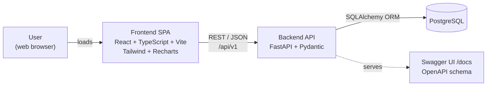
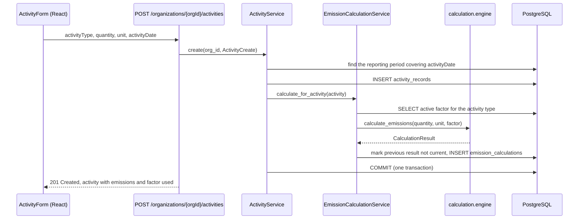
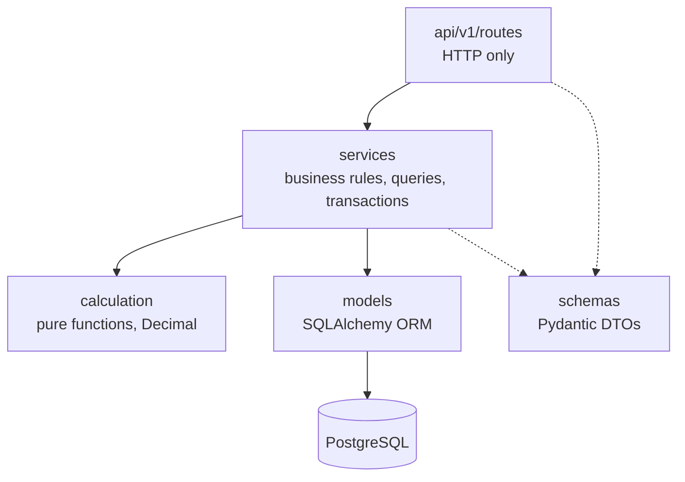
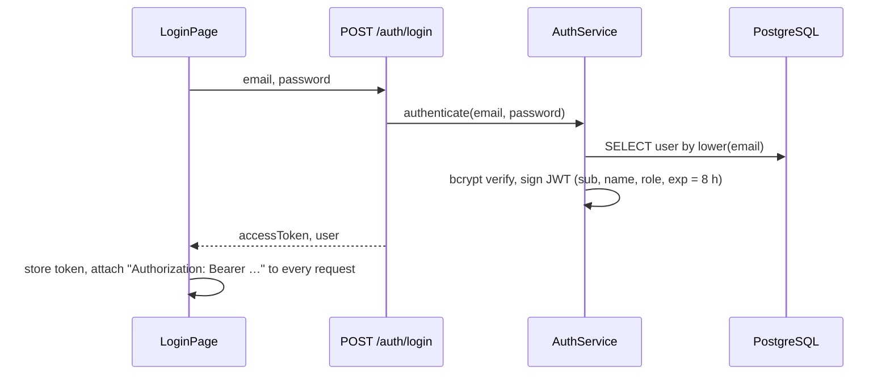
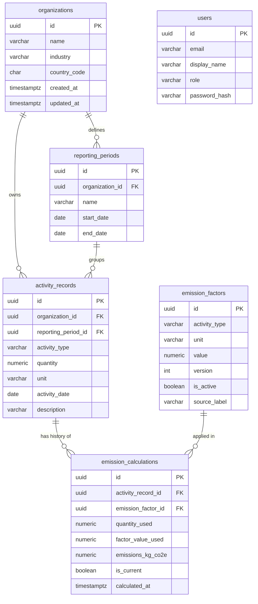
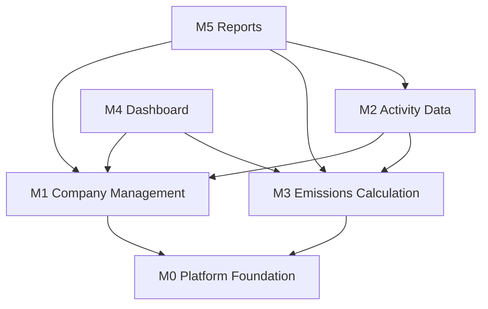

# CarbonTrack — Master Architecture

| | |
|---|---|
| Version | 0.2 |
| Date | 2026-11-10 |
| Status | **Approved at Checkpoint 2** (2026-11-10). v0.2 adds mock login (Q-02) and the BMAD folder layout (Q-01) |
| Inputs | [Master PRD](prd.md) · [Project brief](../analysis/project-brief.md) |

## 1. Architectural drivers

| Driver | Source | Architectural response |
|---|---|---|
| Explainable, reproducible calculations | BR-03, FR-EMI-02/03 | Immutable, versioned factors. Calculation rows snapshot the quantity and factor value used, and history is kept |
| Exact arithmetic | NFR-01 | `Decimal` in Python, `NUMERIC` in PostgreSQL, and rounding in exactly one place (the engine) |
| Business logic kept out of HTTP endpoints | Requirements §5 | Thin routes → services → pure calculation engine |
| Factors configurable without code changes | BR-06, FR-EMI-07 | Factors stored in the database, seeded from a JSON file, new versions added through the API |
| Fast aggregates for dashboard and reports | NFR-02 | Aggregation in SQL over indexed columns, not in Python loops |
| One-command local run with no hardcoded secrets | FR-PLT-05, NFR-06 | Docker Compose plus `.env`, with settings loaded by pydantic-settings |
| Professional, consistent UI | G3 | Design tokens in the Tailwind theme, a reusable UI kit, and standard loading, empty and error components |

## 2. System context



The single-page app in the browser calls a stateless REST API. The API is the only component that talks to the database.

## 3. Technology stack

| Layer | Choice | Notes |
|---|---|---|
| Frontend | React (current stable major), TypeScript `strict`, Vite | Versions pinned in the lockfile at build time |
| Styling | Tailwind CSS v4 | Design tokens defined in CSS via `@theme` |
| Charts | Recharts | Wrapped in project chart components |
| Routing | React Router \* | Needed for sidebar navigation and URL-scoped organizations |
| Server state | TanStack Query \* | Caching plus loading, error and retry states |
| Frontend tests | Vitest, React Testing Library, MSW \* | MSW mocks the API in component tests |
| Backend | Python 3.12, FastAPI | |
| Validation | Pydantic v2, pydantic-settings | Request and response schemas, environment-based settings |
| Mock login | PyJWT, bcrypt † | Signed bearer tokens and password hashing for seeded demo users |
| ORM | SQLAlchemy 2.0 (synchronous), psycopg 3 | See ADR-01 |
| Migrations | Alembic \* | See ADR-03 |
| Backend tests | pytest, httpx (FastAPI TestClient) \* | Real PostgreSQL, see ADR-13 |
| Lint and format | ruff (Python), ESLint and Prettier (TypeScript) \* | |
| Database | PostgreSQL 16 with the `btree_gist` extension | `btree_gist` enables the no-overlap constraint on reporting periods |
| Local runtime | Docker Compose | |
| CI | GitHub Actions \* | Lint and tests on every push (Q-12) |

\* Addition not named in the requirements. Approved at CP2 (Q-08).
† Added in v0.2 because of the mock-login decision (Q-02).

## 4. Container view (local)

| Service | Image or build | Port (bound to localhost) | Responsibility |
|---|---|---|---|
| `db` | `postgres:16-alpine` | 5432 | Data storage, named volume `pgdata`, `pg_isready` health check |
| `backend` | `./backend/Dockerfile` | 8000 | On start: `alembic upgrade head`, then `python -m app.seed` (idempotent, controlled by `SEED_DEMO_DATA`), then `uvicorn --reload` |
| `frontend` | `./frontend/Dockerfile` | 5173 | Vite dev server with hot reload |

`backend` waits for `db` to be healthy. Source folders are bind-mounted for hot reload during development.

## 5. Request flow: recording an activity



## 6. Backend architecture

### 6.1 Layers and rules



| Layer | Folder | Responsibility | May import | Must not |
|---|---|---|---|---|
| Routes | `app/api/v1/routes` | Parse parameters, call one service method, return a response schema, set status codes | schemas, services, `api/deps` | Contain business rules, run queries or commit |
| Schemas | `app/schemas` | Request and response DTOs, field validation, camelCase aliases | pydantic | Import models or services |
| Services | `app/services` | Business rules, queries, transactions, cross-module orchestration | models, schemas, calculation, core | Import FastAPI or other HTTP concepts |
| Calculation engine | `app/calculation` | Deterministic emission arithmetic, activity type and unit definitions | Python standard library only | Perform any I/O |
| Models | `app/models` | Tables, constraints, relationships | `db/base` | Contain business logic |
| Core | `app/core` | Settings, domain exceptions, error handlers, logging | | |
| DB | `app/db` | Engine, session factory, declarative base | `core/config` | |

### 6.2 Transactions

One SQLAlchemy session per request, provided by a FastAPI dependency. A write service method commits once at the end of its work, and any exception rolls the transaction back. An activity write and its calculation share one transaction, so an activity never exists without a current calculation.

### 6.3 Error handling

Services raise domain exceptions. Exception handlers registered in `main.py` translate them into a single error envelope:

```json
{
  "error": {
    "code": "ACTIVITY_DATE_OUTSIDE_PERIODS",
    "message": "No reporting period covers 2026-03-14 for this organization.",
    "details": [{ "field": "activityDate", "issue": "outside_reporting_periods" }],
    "requestId": "b7e2…"
  }
}
```

| Exception | HTTP status | Example codes |
|---|---|---|
| `AuthenticationError` | 401 | `INVALID_CREDENTIALS`, `TOKEN_MISSING`, `TOKEN_EXPIRED` |
| `NotFoundError` | 404 | `ORGANIZATION_NOT_FOUND`, `ACTIVITY_NOT_FOUND` |
| `ConflictError` | 409 | `ORGANIZATION_NAME_TAKEN`, `REPORTING_PERIOD_OVERLAP` |
| `BusinessRuleError` | 422 | `ACTIVITY_DATE_OUTSIDE_PERIODS`, `NO_ACTIVE_FACTOR`, `UNIT_MISMATCH` |
| Pydantic `RequestValidationError` | 422 | `VALIDATION_ERROR`, with per-field details |
| Anything unhandled | 500 | `INTERNAL_ERROR`. Logged with the request ID; the client receives a generic message |

### 6.4 Logging

Structured log lines with a request ID. Middleware reads or creates an `X-Request-ID` header and returns it on every response, so a UI error can be matched to a log line.

### 6.5 Mock authentication (Q-02)



- `core/security.py` holds password hashing and token creation and decoding. The signing secret comes from `AUTH_SECRET_KEY`. HS256 is used, with an 8-hour lifetime and no refresh tokens.
- `api/deps.get_current_user` decodes the token and loads the user. Every router except `health`, `auth/login` and the docs depends on it (FR-AUTH-05). A missing, invalid or expired token returns 401 through the error envelope.
- Roles are carried in the token and shown in the UI. No endpoint checks them (FR-AUTH-04).
- The frontend keeps the token in `localStorage`. `apiClient` attaches it to every request. A 401 response clears the session and redirects to `/login?next=<path>`.
- Logout happens on the client only (the token is discarded). Because tokens are stateless, a discarded token remains valid until it expires. That is acceptable for a demo.

## 7. Calculation engine

The engine is a pure module with no database, FastAPI or I/O imports, which makes it trivially unit-testable.

```python
# app/calculation/engine.py (illustrative)
QUANTUM = Decimal("0.000001")

@dataclass(frozen=True)
class Factor:
    activity_type: ActivityType
    unit: Unit
    value: Decimal  # kg CO2e per unit

@dataclass(frozen=True)
class CalculationResult:
    quantity: Decimal
    unit: Unit
    factor_value: Decimal
    emissions_kg_co2e: Decimal

def calculate_emissions(activity_type: ActivityType, quantity: Decimal,
                        unit: Unit, factor: Factor) -> CalculationResult:
    if factor.activity_type != activity_type:
        raise FactorMismatchError(...)
    if unit != factor.unit:
        raise UnitMismatchError(...)  # extension point for unit conversion (Q-05)
    if quantity <= 0:
        raise InvalidQuantityError(...)
    emissions = (quantity * factor.value).quantize(QUANTUM, rounding=ROUND_HALF_UP)
    return CalculationResult(quantity, unit, factor.value, emissions)
```

- `app/calculation/activity_types.py` is the single source of truth for activity types, their canonical units and scope labels. Schemas, services and the reference-data endpoint all read from it.
- **Factor lifecycle.** Adding version *n+1* for a type deactivates the current version and inserts the new one in a single transaction. A partial unique index guarantees at most one active factor per type. Factor values are never updated.
- **Recalculation (FR-EMI-10).** For each of the organization's activities whose current result used a non-active factor, mark that result not current and insert a new one.
- **Aggregation** happens in SQL in `EmissionsQueryService`: `SUM(emissions_kg_co2e)` over current results, grouped by `activity_type` and `date_trunc('month', activity_date)`.

## 8. Data architecture

### 8.1 Entity relationships



### 8.2 Tables

Every table has a `UUID` primary key `id`. Mutable tables also have `created_at` and `updated_at` (`TIMESTAMPTZ`, UTC).

**users** (added in v0.2 for mock login; no foreign keys to business tables)

| Column | Type | Constraints |
|---|---|---|
| email | `VARCHAR(254)` | NOT NULL, unique index on `lower(email)` |
| display_name | `VARCHAR(100)` | NOT NULL |
| role | `VARCHAR(32)` | NOT NULL, CHECK in ('sustainability_manager', 'data_contributor', 'executive_viewer', 'administrator') |
| password_hash | `VARCHAR(100)` | NOT NULL, bcrypt hash |

**organizations**

| Column | Type | Constraints |
|---|---|---|
| name | `VARCHAR(200)` | NOT NULL, unique index on `lower(name)` |
| industry | `VARCHAR(100)` | NOT NULL, validated against the predefined list |
| country_code | `CHAR(2)` | NOT NULL, ISO 3166-1 alpha-2 |

**reporting_periods**

| Column | Type | Constraints |
|---|---|---|
| organization_id | `UUID` | FK → organizations, ON DELETE CASCADE |
| name | `VARCHAR(50)` | NOT NULL, UNIQUE (organization_id, name) |
| start_date, end_date | `DATE` | NOT NULL, CHECK (end_date >= start_date) |

Also: an EXCLUDE constraint using `btree_gist` on `(organization_id WITH =, daterange(start_date, end_date, '[]') WITH &&)` so an organization's periods cannot overlap, and UNIQUE (id, organization_id) as the target of the composite foreign key below.

**activity_records**

| Column | Type | Constraints |
|---|---|---|
| organization_id | `UUID` | NOT NULL, FK → organizations, ON DELETE CASCADE |
| reporting_period_id | `UUID` | NOT NULL. Composite FK (reporting_period_id, organization_id) → reporting_periods (id, organization_id), ON DELETE RESTRICT, so the period always belongs to the same organization |
| activity_type | `VARCHAR(32)` | NOT NULL, CHECK in ('electricity', 'fuel', 'business_travel') |
| quantity | `NUMERIC(18,3)` | NOT NULL, CHECK (quantity > 0) |
| unit | `VARCHAR(16)` | NOT NULL, CHECK that (activity_type, unit) is a valid pair |
| activity_date | `DATE` | NOT NULL (the "reporting date", A-05) |
| description | `VARCHAR(500)` | NULL |

Indexes: (organization_id, activity_date), (reporting_period_id, activity_type).

**emission_factors** (rows are immutable once created)

| Column | Type | Constraints |
|---|---|---|
| activity_type | `VARCHAR(32)` | NOT NULL |
| unit | `VARCHAR(16)` | NOT NULL (the "per unit" of the factor) |
| value | `NUMERIC(12,6)` | NOT NULL, CHECK (value >= 0), kg CO2e per unit |
| version | `INTEGER` | NOT NULL, UNIQUE (activity_type, version) |
| is_active | `BOOLEAN` | NOT NULL. Partial unique index on (activity_type) WHERE is_active |
| source_label | `VARCHAR(200)` | NOT NULL, default "Demonstration value, not an official emission factor" |

**emission_calculations**

| Column | Type | Constraints |
|---|---|---|
| activity_record_id | `UUID` | NOT NULL, FK → activity_records, ON DELETE CASCADE |
| emission_factor_id | `UUID` | NOT NULL, FK → emission_factors, ON DELETE RESTRICT |
| quantity_used | `NUMERIC(18,3)` | NOT NULL, snapshot of the activity quantity |
| factor_value_used | `NUMERIC(12,6)` | NOT NULL, snapshot of the factor value |
| emissions_kg_co2e | `NUMERIC(20,6)` | NOT NULL |
| is_current | `BOOLEAN` | NOT NULL. Partial unique index on (activity_record_id) WHERE is_current |
| calculated_at | `TIMESTAMPTZ` | NOT NULL |

### 8.3 Migrations and seed data

- Alembic manages the schema. `create_all` is never used outside tests. The first migration enables `btree_gist`.
- `python -m app.seed` is idempotent. It inserts version 1 of each factor from `app/seed/emission_factors.json` when no factor exists for that type. If `SEED_DEMO_DATA=true`, it then creates the four demo users (one per persona, sharing the password from `DEMO_USER_PASSWORD`) and fictional demo organizations with 18 months of activity (Q-14).

## 9. API design

### 9.1 Conventions

- Base path `/api/v1`. Plural resource names, kebab-case paths. Organization-scoped resources are nested under `/organizations/{orgId}`.
- JSON bodies use camelCase through a Pydantic alias generator. Python code stays snake_case.
- Decimal values are serialized as JSON numbers at a fixed precision. All arithmetic happens on the server, and the client only formats values (ADR-09).
- Dates are `YYYY-MM-DD`. Timestamps are ISO 8601 in UTC.
- Pagination: `?page=1&pageSize=25` (maximum 100) returns `{ items, page, pageSize, total }`. Sorting: `?sort=-activityDate`.
- Status codes: 200, 201 with `Location`, 204 for deletes, and 404, 409, 422 or 500 using the error envelope (§6.3).
- OpenAPI is generated by FastAPI, with summaries, descriptions and examples on every route. Swagger UI is at `/docs`.

### 9.2 Endpoints

| Method | Path | Purpose | FR | Module |
|---|---|---|---|---|
| GET | `/health` | API and database status (no token needed) | PLT-03 | M0 |
| POST | `/auth/login` | Exchange email and password for a token and user profile (no token needed) | AUTH-01 | M0 |
| GET | `/auth/me` | Current user, used to restore a session on reload | AUTH-03 | M0 |
| GET | `/reference-data` | Activity types (unit, scope), industries, countries | PLT-06 | M0 |
| GET | `/organizations` | List organizations | ORG-02 | M1 |
| POST | `/organizations` | Create an organization with its first reporting period | ORG-01 | M1 |
| GET | `/organizations/{orgId}` | Details and headline figures | ORG-03 | M1 |
| PATCH | `/organizations/{orgId}` | Update the profile | ORG-04 | M1 |
| GET | `/organizations/{orgId}/reporting-periods` | List periods | ORG-05 | M1 |
| POST | `/organizations/{orgId}/reporting-periods` | Add a period | ORG-05 | M1 |
| PATCH | `/organizations/{orgId}/reporting-periods/{periodId}` | Edit a period | ORG-05 | M1 |
| GET | `/organizations/{orgId}/activities` | Filtered, paginated, sorted list with current emissions | ACT-04 | M2 |
| POST | `/organizations/{orgId}/activities` | Create and calculate | ACT-01–03, EMI-01 | M2 |
| GET | `/organizations/{orgId}/activities/{activityId}` | Detail, including calculation history | EMI-02/03 | M2 |
| PATCH | `/organizations/{orgId}/activities/{activityId}` | Update and recalculate | ACT-05 | M2 |
| DELETE | `/organizations/{orgId}/activities/{activityId}` | Delete | ACT-06 | M2 |
| GET | `/emission-factors` | Active factors and version history | EMI-07/08 | M3 |
| POST | `/emission-factors` | Add a new version (deactivates the previous one) | EMI-07 | M3 |
| GET | `/organizations/{orgId}/emissions/summary?periodId=` | Total and breakdown by type with shares | EMI-04/05, DSH-01/03 | M3 |
| GET | `/organizations/{orgId}/emissions/monthly?periodId=` | Monthly totals by type | EMI-06, DSH-02 | M3 |
| POST | `/organizations/{orgId}/emissions/recalculate` | Recalculate with the active factors | EMI-10 | M3 |
| GET | `/organizations/{orgId}/reports/emissions?periodId=&activityType=` | Summary and line items | RPT-01–03 | M5 |
| GET | `/organizations/{orgId}/reports/emissions/export?periodId=&activityType=&part=lines\|summary` | CSV download | RPT-04/05 | M5 |

Example activity response:

```json
{
  "id": "6f1c…",
  "organizationId": "a2d9…",
  "reportingPeriodId": "c41e…",
  "activityType": "electricity",
  "quantity": 12400.0,
  "unit": "kWh",
  "activityDate": "2026-03-31",
  "description": "Head office utility bill, March",
  "emissions": {
    "emissionsKgCo2e": 6200.0,
    "calculatedAt": "2026-04-02T09:14:00Z",
    "factor": {
      "id": "e07b…",
      "value": 0.5,
      "unit": "kWh",
      "version": 1,
      "sourceLabel": "Demonstration value, not an official emission factor"
    }
  }
}
```

## 10. Frontend architecture

### 10.1 Layers

| Folder | Responsibility | Rule |
|---|---|---|
| `layouts/` | App shell: sidebar, top bar, organization switcher, content outlet | No data fetching other than the organization list |
| `pages/` | One component per route. Composes hooks and components | No direct `fetch` calls |
| `components/ui/` | Reusable, presentational UI kit (Button, Card, StatCard, DataTable, Modal, FormField, Select, Badge, Skeleton, EmptyState, ErrorState, Toast) | Props in, events out, no API knowledge |
| `components/<feature>/` | Feature components (ActivityForm, ActivityTable, ReportFilters, …) | May use hooks |
| `components/charts/` | Recharts wrappers with shared tokens, tooltips and an accessible table equivalent | Receive data through props |
| `hooks/` | TanStack Query hooks per resource (`useActivities`, `useEmissionsSummary`, …) and UI hooks (`useSelectedPeriod`) | The only place that calls services |
| `services/` | Typed API functions over `apiClient.ts` (base URL from `VITE_API_BASE_URL`, JSON handling, conversion of error envelopes to `ApiError`) | No React imports |
| `types/` | API and domain TypeScript types | |
| `utils/` | Formatters (kg and t CO2e, numbers, dates) and the CSV download helper | Pure functions |

Data flow: **page → hook → service → apiClient → API**. Mutations invalidate the related queries, so the dashboard updates after an activity is saved.

### 10.2 Routes

| Path | Page |
|---|---|
| `/login` | Sign-in page with the demo accounts listed (public route) |
| `/` | Redirects to the last-used organization's dashboard, or to `/organizations` |
| `/organizations` | Organization list and entry point for creating one |
| `/organizations/new` | Create-organization form (with the first reporting period) |
| `/organizations/:orgId/dashboard` | Dashboard |
| `/organizations/:orgId/activities` | Activity table, add and edit dialogs |
| `/organizations/:orgId/reports` | Reports and export |
| `/organizations/:orgId/settings` | Organization profile and reporting periods |
| `/emission-factors` | Factors and version history (global) |
| `*` | Not found |

Every route except `/login` is wrapped in a `RequireAuth` guard. The organization lives in the URL, and the selected period lives in the query string (`?period=<id>`). Views can therefore be linked and bookmarked, and the dashboard and reports share the same selection. The last-used organization ID is remembered in `localStorage`.

### 10.3 UI state pattern

Every data-driven view goes through the same states: skeleton while loading, an error panel with a message and Retry, an empty state with a primary action, then content. Forms show field-level errors from client validation and from the API's `details`. The server remains the authority on validation.

### 10.4 Design system hook-in

Colours (brand greens, neutrals, semantic colours, one chart colour per activity type), typography, spacing, radius and shadows are design tokens in `src/styles/index.css` (Tailwind v4 `@theme`). The UX phase (CP4) defines the actual values. Components use only tokens, never raw hex values.

## 11. Module boundaries and dependencies

### 11.1 Ownership

| Module | Owns tables | Backend | Frontend |
|---|---|---|---|
| M0 Platform | users | `core/` (including `security.py`), `db/`, `main.py`, `api/deps.py`, health, auth and reference-data routes, `auth_service`, `seed/` | `layouts/`, `components/ui/`, `components/auth/`, `LoginPage`, `services/apiClient.ts`, `services/authService.ts`, `styles/`, routing |
| M1 Company | organizations, reporting_periods | `organization_service`, `reporting_period_service`, organization and period routes | Organization pages, `components/organization/` |
| M2 Activity | activity_records | `activity_service`, activity routes | `ActivitiesPage`, `components/activities/` |
| M3 Emissions | emission_factors, emission_calculations | `calculation/`, `emission_factor_service`, `emission_calculation_service`, `emissions_query_service`, factor and emissions routes | `EmissionFactorsPage`, `components/emissions/` |
| M4 Dashboard | none | none (reads M3 endpoints) | `DashboardPage`, `components/charts/`, `components/dashboard/` |
| M5 Reports | none | `report_service`, report routes | `ReportsPage`, `components/reports/` |

### 11.2 Dependency graph

Arrows mean "depends on".



Allowed service-to-service calls:

- `ActivityService` → `ReportingPeriodService` (find the covering period) and `EmissionCalculationService` (calculate on write).
- `EmissionCalculationService` → `EmissionFactorService` (active factor) and the calculation engine.
- `ReportService` → `EmissionsQueryService` (aggregates) and `ActivityService` (line items).

`emission_calculations` has a foreign key to `activity_records`. That is a data-level reference only: M3 services read the `ActivityRecord` model but never call `ActivityService`, which keeps the code dependency graph acyclic.

### 11.3 Build order

1. **M0** Platform Foundation: compose, settings, DB session, error envelope, mock login, app shell, UI kit.
2. **M1** Company Management.
3. **M3a** Emission factors and the pure calculation engine (no dependency on activities).
4. **M2** Activity Data, together with **M3b** calculation persistence (writing an activity triggers a calculation).
5. **M3c** Aggregations (summary, monthly).
6. **M4** Dashboard and **M5** Reports, which can be built in parallel.

## 12. Cross-cutting concerns

### 12.1 Configuration

All configuration comes from environment variables. `.env.example` is committed with placeholder values, and `.env` is git-ignored.

| Variable | Used by | Example in `.env.example` |
|---|---|---|
| `POSTGRES_USER`, `POSTGRES_PASSWORD`, `POSTGRES_DB` | db, backend | `carbontrack`, `change-me`, `carbontrack` |
| `POSTGRES_HOST`, `POSTGRES_PORT` | backend | `db`, `5432` |
| `TEST_DATABASE_NAME` | backend tests | `carbontrack_test` |
| `CORS_ORIGINS` | backend | `http://localhost:5173` |
| `APP_ENV`, `LOG_LEVEL` | backend | `development`, `INFO` |
| `SEED_DEMO_DATA` | backend | `true` |
| `AUTH_SECRET_KEY` | backend | `change-me-to-a-long-random-string` |
| `AUTH_TOKEN_TTL_MINUTES` | backend | `480` |
| `DEMO_USER_PASSWORD` | backend (seed) | `change-me` |
| `VITE_API_BASE_URL` | frontend | `http://localhost:8000/api/v1` |

### 12.2 Security (demo level)

Mock login (§6.5, ADR-12) keeps casual visitors out, but it is not production security, so compose still binds ports to `127.0.0.1` only. Passwords are stored as bcrypt hashes and the token secret comes from the environment. CORS uses an explicit allowlist. The ORM parameterizes all queries. Every input is validated by Pydantic and by service rules. Error responses never include stack traces or SQL.

### 12.3 Validation

The same rule can exist in three places, each for a different reason:

| Layer | Purpose |
|---|---|
| Client | Instant feedback |
| Pydantic schema | Shape, types and ranges |
| Service and database constraint | Business rules (period coverage, uniqueness, overlap) and a final guarantee |

## 13. Testing strategy

| Level | Tooling | Scope |
|---|---|---|
| Engine unit tests | pytest | Table-driven tests of the three demo factors, rounding, mismatched type or unit, invalid quantity |
| Service integration tests | pytest with real PostgreSQL | Business rules (period coverage, overlap, factor versioning, recalculation, history), aggregation queries, and credential checks. Each test runs in a rolled-back transaction |
| API tests | pytest with TestClient | Every endpoint's happy path and main error path, status codes, error envelope shape, and a 401 for protected routes called without a token |
| Golden dataset | pytest | A fixed dataset with hand-checked expected totals by type and month (NFR-01) |
| Frontend unit and component tests | Vitest, React Testing Library | Formatters, UI kit components, ActivityForm validation |
| Page state tests | Vitest, RTL, MSW | Dashboard and Reports loading, empty, error and content states |
| End-to-end | Out of scope for the MVP | Playwright is a candidate for later |

The test database is created and migrated by the pytest session fixture, using the compose PostgreSQL instance.

## 14. Proposed repository structure

```text
BMAD-Practice-demo/
├── README.md                          # setup and run instructions (Build phase)
├── docker-compose.yml
├── .env.example                       # every variable, placeholder values only
├── .gitignore
├── .github/workflows/ci.yml           # lint and tests (Q-12)
├── _bmad/                             # BMAD Method v6.12.4 install: config, scripts, manifests
├── .claude/skills/                    # BMAD agents and workflows as Claude Code skills
├── docs/                              # BMAD output folder
│   ├── README.md                      # index, workflow status, approval log
│   ├── analysis/
│   │   └── project-brief.md
│   ├── planning/                      # BMAD planning_artifacts
│   │   ├── .memlog.md                 # BMAD decision trail (append-only)
│   │   ├── prd.md
│   │   ├── architecture.md
│   │   ├── assumptions-and-open-questions.md
│   │   ├── modules/                   # m0-platform-prd.md … m5-reports-prd.md (CP3)
│   │   ├── ux-design-specification.md # plus design-system docs (CP4)
│   │   └── epics.md                   # epics and stories (CP5)
│   └── implementation/                # BMAD implementation_artifacts
│       ├── sprint-status.yaml         # story tracking
│       ├── stories/                   # one file per story
│       └── reviews/                   # code reviews, retrospectives, course corrections
├── backend/
│   ├── Dockerfile
│   ├── pyproject.toml
│   ├── alembic.ini
│   ├── alembic/
│   │   ├── env.py
│   │   └── versions/
│   ├── app/
│   │   ├── main.py                    # app factory: routers, middleware, error handlers
│   │   ├── core/
│   │   │   ├── config.py              # pydantic-settings, reads environment variables
│   │   │   ├── security.py            # password hashing, token signing and decoding
│   │   │   ├── exceptions.py          # domain exceptions
│   │   │   ├── error_handlers.py      # exception → error envelope
│   │   │   └── logging.py
│   │   ├── db/
│   │   │   ├── base.py                # declarative base, constraint naming conventions
│   │   │   └── session.py             # engine, session factory, get_db
│   │   ├── models/
│   │   │   ├── user.py
│   │   │   ├── organization.py
│   │   │   ├── reporting_period.py
│   │   │   ├── activity_record.py
│   │   │   ├── emission_factor.py
│   │   │   └── emission_calculation.py
│   │   ├── schemas/
│   │   │   ├── common.py              # camelCase base model, pagination, error envelope
│   │   │   ├── auth.py
│   │   │   ├── organization.py
│   │   │   ├── reporting_period.py
│   │   │   ├── activity.py
│   │   │   ├── emission_factor.py
│   │   │   ├── emissions.py           # summary, monthly trend
│   │   │   └── report.py
│   │   ├── services/
│   │   │   ├── auth_service.py
│   │   │   ├── organization_service.py
│   │   │   ├── reporting_period_service.py
│   │   │   ├── activity_service.py
│   │   │   ├── emission_factor_service.py
│   │   │   ├── emission_calculation_service.py
│   │   │   ├── emissions_query_service.py
│   │   │   ├── report_service.py      # report assembly and CSV writing
│   │   │   └── reference_data_service.py
│   │   ├── calculation/
│   │   │   ├── engine.py              # pure calculation functions
│   │   │   └── activity_types.py      # types, canonical units, scope labels
│   │   ├── api/
│   │   │   ├── deps.py                # get_db, get_current_user, pagination parameters
│   │   │   └── v1/
│   │   │       ├── router.py
│   │   │       └── routes/
│   │   │           ├── health.py
│   │   │           ├── auth.py
│   │   │           ├── reference_data.py
│   │   │           ├── organizations.py
│   │   │           ├── reporting_periods.py
│   │   │           ├── activities.py
│   │   │           ├── emission_factors.py
│   │   │           ├── emissions.py
│   │   │           └── reports.py
│   │   └── seed/
│   │       ├── __main__.py            # python -m app.seed
│   │       ├── emission_factors.json  # configurable demonstration factors
│   │       └── demo_data.py           # demo users, fictional organizations, 18 months of activity
│   └── tests/
│       ├── conftest.py                # test database, transactional fixtures, API client
│       ├── unit/                      # calculation engine, pure helpers
│       ├── integration/               # services against PostgreSQL
│       └── api/                       # endpoints, error envelope
└── frontend/
    ├── Dockerfile
    ├── package.json
    ├── vite.config.ts
    ├── tsconfig.json
    ├── index.html
    └── src/
        ├── main.tsx
        ├── App.tsx                    # providers (QueryClient, Router, Auth)
        ├── routes.tsx
        ├── layouts/
        │   └── AppLayout.tsx          # sidebar, top bar (org switcher, user menu), outlet
        ├── pages/
        │   ├── LoginPage.tsx
        │   ├── OrganizationsPage.tsx
        │   ├── CreateOrganizationPage.tsx
        │   ├── OrganizationSettingsPage.tsx
        │   ├── DashboardPage.tsx
        │   ├── ActivitiesPage.tsx
        │   ├── ReportsPage.tsx
        │   ├── EmissionFactorsPage.tsx
        │   └── NotFoundPage.tsx
        ├── components/
        │   ├── ui/                    # Button, Card, StatCard, DataTable, Modal, FormField,
        │   │                          # Select, Badge, Skeleton, EmptyState, ErrorState, Toast
        │   ├── auth/                  # AuthProvider, RequireAuth, UserMenu
        │   ├── charts/                # ChartCard, EmissionsTrendChart, EmissionsBreakdownChart
        │   ├── dashboard/             # SummaryCards, PeriodSelector
        │   ├── organization/          # OrganizationForm, ReportingPeriodForm, OrgSwitcher
        │   ├── activities/            # ActivityForm, ActivityTable, ActivityFilters
        │   ├── emissions/             # FactorBadge, FactorTable, DisclaimerNote
        │   └── reports/               # ReportFilters, ReportSummary, ExportButton
        ├── services/
        │   ├── apiClient.ts           # fetch wrapper, base URL, bearer token, ApiError
        │   ├── authService.ts
        │   ├── organizationService.ts
        │   ├── activityService.ts
        │   ├── emissionFactorService.ts
        │   ├── emissionsService.ts
        │   └── reportService.ts
        ├── hooks/                     # useOrganizations, useActivities, useEmissionsSummary,
        │                              # useMonthlyEmissions, useReport, useSelectedPeriod …
        ├── types/                     # organization.ts, activity.ts, emissions.ts, api.ts
        ├── utils/                     # formatters, download helpers
        ├── styles/
        │   └── index.css              # Tailwind import and design tokens (@theme)
        └── test/                      # setup, MSW handlers, render helpers
```

Component tests sit next to their components as `*.test.tsx`.

## 15. Architecture decisions

| ADR | Decision | Rationale | Alternative considered |
|---|---|---|---|
| 01 | Synchronous SQLAlchemy 2.0 with psycopg 3 | Simpler code and tests. FastAPI runs sync endpoints in a thread pool, which is ample at demo scale | Async SQLAlchemy |
| 02 | Services own their queries; no repository layer | Five tables. Repositories would add indirection without benefit. Revisit if queries start being duplicated | Repository pattern |
| 03 | Alembic migrations | Versioned schema history, reproducible databases | `create_all` on startup |
| 04 | `Decimal` and `NUMERIC`, with rounding only in the engine | Exact results and a single rounding point | float |
| 05 | Versioned, immutable factors. Calculations snapshot their inputs and keep history through `is_current` | Every number stays explainable and reproducible | Overwriting factors and results in place |
| 06 | Calculate synchronously in the activity write transaction | An activity never exists without a current result. Simple | Background job queue |
| 07 | An activity's period is derived from its date, and a composite FK guarantees it belongs to the same organization | Integrity and simple filtering | Client-chosen period, or date-range queries only |
| 08 | Aggregate in SQL | Meets NFR-02 | Aggregating in Python |
| 09 | camelCase JSON through Pydantic aliases, with decimals sent as JSON numbers | Idiomatic TypeScript on the client. Values are far inside float64 precision, and the client only displays them | snake_case JSON, or decimals as strings |
| 10 | UUID primary keys | IDs in URLs are not guessable or enumerable | Serial integers |
| 11 | TanStack Query for server state, with the organization and period in the URL | Built-in loading, error and caching behaviour, plus shareable links | Hand-written `useEffect` hooks, a global store |
| 12 | Mock login: seeded users, bcrypt hashes, stateless HS256 JWT bearer tokens stored in `localStorage`, roles not enforced (Q-02) | Makes the demo feel like a real SaaS at low cost, with no session store | No authentication; httpOnly cookie sessions (needs CSRF handling); a real identity provider |
| 13 | Integration tests use real PostgreSQL | Partial indexes, exclusion constraints and `NUMERIC` behaviour are PostgreSQL-specific | SQLite |

## 16. Risks and known limitations

| Item | Note |
|---|---|
| Mock login only | Shared demo password, tokens in `localStorage` (exposed to XSS), no revocation, roles not enforced. Mitigated by binding to localhost. Real authentication is required before any shared deployment |
| One factor per activity type | Cannot express regional or yearly factors. Extension path: add `region` and `valid_from`/`valid_to` to `emission_factors`, and select by activity date and organization country |
| No unit conversion | The engine's unit check is the extension point (Q-05) |
| Decimals sent as floats at the API boundary | Fine for display. Revisit if other systems consume the API for further computation |

## Change log

| Version | Date | Change |
|---|---|---|
| 0.1 | 2026-11-10 | Initial draft for CP2 |
| 0.2 | 2026-11-10 | CP2 approved. Q-02 mock login: §6.5, users table, auth endpoints, 401 error, auth env vars, ADR-12 rewritten, folder additions. Q-01: BMAD folders and the BMAD `docs/` layout (planning vs implementation artifacts) in §14 |
